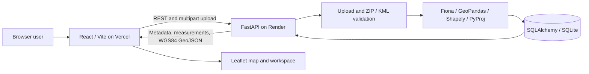

# AEREO — Geospatial Measurement Studio

AEREO helps GIS analysts, survey teams, and developers upload spatial files, inspect feature geometry and attributes, and review defensible area and distance measurements. The React workspace accepts KML and zipped Shapefiles, displays available features on an interactive map, and retrieves processing results from a FastAPI service. Geographic longitude and latitude are angular coordinates: measuring directly in degrees would not produce metres or square metres. AEREO records the source CRS, transforms measurable geometry to a suitable projected CRS, and reports failures explicitly.

## Contents

- [Live deployment](#live-deployment)
- [Features and limits](#features-and-limits)
- [Technology stack](#technology-stack)
- [Architecture](#architecture)
- [API reference](#api-reference)
- [Local development](#local-development)
- [Environment configuration](#environment-configuration)
- [CRS and measurement policy](#crs-and-measurement-policy)
- [Validation, errors, and status](#validation-errors-and-status)
- [Testing and quality checks](#testing-and-quality-checks)
- [Project structure and design decisions](#project-structure-and-design-decisions)
- [Current limitations](#current-limitations)
- [Learning Outcomes](#learning-outcomes)
- [Future Improvements](#future-improvements)

## Live deployment

| Service | URL |
| --- | --- |
| React application (Vercel) | [aereo-assessment.vercel.app](https://aereo-assessment.vercel.app) |
| FastAPI backend (Render) | [aereo-assessment.onrender.com](https://aereo-assessment.onrender.com) |
| Swagger / OpenAPI documentation | [API documentation](https://aereo-assessment.onrender.com/docs) |
| Backend health | [Health endpoint](https://aereo-assessment.onrender.com/health) |

The API does not define a `/` route; use `/docs` or `/health` to confirm it is serving requests.

The Render free web service can spin down after 15 minutes without traffic; the next request may take about a minute to wake it. Its filesystem is ephemeral: with the default local SQLite database, file and feature records can disappear when the service spins down, restarts, or redeploys. Uploaded originals are processed in a temporary directory and then deleted; they are not stored permanently. The public deployment is therefore a demonstration, not a durable data store. See [Render's free-service limitations](https://render.com/docs/free).

## Features and limits

- Accepts `.kml` and `.zip` Shapefile uploads, validates contents, and limits upload size.
- Stores file metadata and each feature's ID, index, geometry, type, properties, source CRS, measurement, target CRS, status, and diagnostic.
- Measures Polygon and MultiPolygon area in **square metres (`m2`)** and LineString and MultiLineString length in **metres (`m`)**. Point and MultiPoint return `NOT_APPLICABLE`.
- Uses projected coordinates selected for each feature; errors are explicit when CRS, geometry, or projection prevents a measurement.
- Provides upload, persisted file listing, file metadata, paginated measurements, map-safe GeoJSON, and health endpoints.

The interface provides Overview, Upload Files, Map Workspace, Measurements, File History, and API Status. Counts and history come from server records. The map loads WGS84 GeoJSON in pages of 500, up to **2,000 loaded features per view**. An attributed OpenStreetMap tile layer supplies the basemap; geometry remains interactive if tiles fail. The measurement table is paginated separately.

Uploads are synchronous. The UI shows an indeterminate processing state and uses the actual returned status and file ID. The backend's default upload limit is **20 MiB**, with a **10,000-feature** processing limit. Polygon perimeter is not calculated. The browser checks the default file limit early, while server validation is authoritative.

## Technology stack

| Layer | Implementation |
| --- | --- |
| Frontend | React, TypeScript, Vite, Tailwind CSS, local shadcn-style UI components, Lucide, React Router, TanStack Query, Zod, React Leaflet, Leaflet |
| API | Python, FastAPI, Uvicorn, Pydantic |
| Geospatial processing | Fiona for Shapefiles; GeoPandas for UTM estimation; Shapely and PyProj for geometry, transformations, and measurements; defusedxml for KML parsing |
| Persistence | SQLAlchemy 2 and SQLite by default; PostgreSQL URL support is configurable but untested |
| Testing and quality | Pytest, FastAPI TestClient, httpx, Ruff; Vitest, Testing Library, ESLint, TypeScript, Prettier |
| Deployment | Vercel frontend; Render Python web service |

## Architecture



The frontend handles file selection, navigation, filtering, map interaction, and display formatting; the backend owns validation, CRS interpretation, and measurement. The typed client uses `VITE_API_BASE_URL` and checks response shapes. During upload, FastAPI bounds the request body, copies the file to an isolated temporary directory, parses the supported dataset, processes individual features, and commits file and feature records. It removes the temporary input after processing. The measurement endpoint retains source-coordinate geometry; a separate map endpoint transforms displayable geometry to WGS84 GeoJSON. File-level and per-feature errors remain queryable instead of being represented as zero measurements.

## API reference

| Method | Path | Purpose |
| --- | --- | --- |
| `POST` | `/api/files/` | Multipart upload; field name `upload` |
| `GET` | `/api/files/?limit=20&offset=0&search=&status=` | Persisted file history, newest first; limit 1–100 |
| `GET` | `/api/files/{file_id}/` | Stored file metadata and status |
| `GET` | `/api/files/{file_id}/measurements/?limit=100&offset=0` | Feature details and measurements; limit 1–500; optional `search`, `geometry_type`, `measurement_status`, `sort`, `direction` |
| `GET` | `/api/files/{file_id}/features/geojson/?limit=500&offset=0` | Paginated map geometry transformed to WGS84; limit 1–500 |
| `GET` | `/health` | Basic process health |

The full request and response schemas are available in [Swagger UI](https://aereo-assessment.onrender.com/docs). From the repository root, with the local API running:

```powershell
curl.exe -F "upload=@samples/example.kml" http://127.0.0.1:8000/api/files/
curl.exe -F "upload=@samples/sample-points.zip" http://127.0.0.1:8000/api/files/
curl.exe http://127.0.0.1:8000/api/files/REPLACE_WITH_ID/
curl.exe "http://127.0.0.1:8000/api/files/REPLACE_WITH_ID/measurements/?limit=100&offset=0"
curl.exe "http://127.0.0.1:8000/api/files/?limit=20&offset=0"
curl.exe "http://127.0.0.1:8000/api/files/REPLACE_WITH_ID/features/geojson/?limit=500&offset=0"
```

`samples/sample-points.zip` contains one **Point** in EPSG:4326, so its measurement is `NOT_APPLICABLE`. `samples/example.kml` contains a point, line, and polygon near 77°E, 12°N. `scripts/make_sample_shapefile.py` can regenerate the checked-in point ZIP if needed. Original upload files are not retained; extracted geometry and results are stored in the configured database.

A successful upload of the checked-in KML returns HTTP 201 with this shape (ID and timestamp vary):

```json
{
  "id": "<file-id>",
  "original_filename": "example.kml",
  "file_format": "kml",
  "source_crs": "EPSG:4326",
  "feature_count": 3,
  "processing_status": "COMPLETED",
  "created_at": "<UTC timestamp>",
  "error_summary": null,
  "file_url": "/api/files/<file-id>/",
  "measurements_url": "/api/files/<file-id>/measurements/"
}
```

The measurement endpoint returns `file_id`, `total`, `limit`, `offset`, and `items`. A representative item is:

```json
{
  "feature_index": 1,
  "feature_id": "route-1",
  "geometry_type": "LineString",
  "geometry": {"type": "LineString", "coordinates": [[77.0, 12.0], [77.01, 12.0]]},
  "properties": {"name": "Short route"},
  "source_crs": "EPSG:4326",
  "projected_crs": "EPSG:32643",
  "measurement_type": "length",
  "measurement_value": 1089.23303449372,
  "measurement_unit": "m",
  "measurement_status": "MEASURED",
  "error": null
}
```

The value shown was calculated from `samples/example.kml` in this checkout; small numerical differences across geospatial library versions are possible. Point records contain null measurement fields and `NOT_APPLICABLE`.

The map endpoint returns `{file_id, crs: "EPSG:4326", total, limit, offset, items}`. Each item has `feature_index`, `feature_id`, `geometry_type`, `geometry`, `properties`, and `error`. Its geometry is WGS84 GeoJSON in **longitude, latitude** order. For backward compatibility, the measurement endpoint's `geometry` remains in the **source CRS**; projected source coordinates must not be passed directly to Leaflet. Unknown CRS, invalid, empty, and unsupported map geometries return `geometry: null` with an explanation. Map availability is distinct from whether a physical measurement succeeded.

## Local development

Use Python **3.11 or 3.12** (`pyproject.toml` requires `>=3.11,<3.13`), Node.js compatible with Vite 8 (20.19+ or 22.12+), and npm. The repository's `.python-version` requests 3.12 on Render. Local backend checks below were run with Python 3.11; Python 3.12 was not available locally. Native geospatial wheels must be available for the selected Python and platform.

### Windows PowerShell

```powershell
git clone https://github.com/shivv-byri/aereo-assessment.git
cd aereo-assessment
py -3.11 -m venv .venv
.\.venv\Scripts\Activate.ps1
python -m pip install -e ".[dev]"
$env:DATABASE_URL = "sqlite:///./aereo.db"
$env:MAX_UPLOAD_BYTES = "20971520"
$env:CORS_ORIGINS = "http://localhost:5173,http://127.0.0.1:5173"
python -m uvicorn app.main:app --reload --host 127.0.0.1 --port 8000
```

In a second PowerShell terminal, from the repository root:

```powershell
cd frontend
Copy-Item .env.example .env.local
npm ci
npm run dev
```

### macOS / Linux

Use `python3.12` below if available; `python3.11` also satisfies the project requirement. Run the backend and frontend in separate terminals.

```bash
git clone https://github.com/shivv-byri/aereo-assessment.git
cd aereo-assessment
python3.12 -m venv .venv
source .venv/bin/activate
python -m pip install -e '.[dev]'
export DATABASE_URL=sqlite:///./aereo.db
export MAX_UPLOAD_BYTES=20971520
export CORS_ORIGINS=http://localhost:5173,http://127.0.0.1:5173
python -m uvicorn app.main:app --reload --host 127.0.0.1 --port 8000
```

```bash
cd aereo-assessment/frontend
cp .env.example .env.local
npm ci
npm run dev
```

Open [the local frontend](http://127.0.0.1:5173), [backend health](http://127.0.0.1:8000/health), or [local Swagger UI](http://127.0.0.1:8000/docs). The backend creates tables on startup. Its `.env.example` lists defaults but is **not automatically loaded**; set shell or hosting environment variables as shown. Vite reads `frontend/.env.local` for local development. Keep real `.env` files and secrets out of Git.

## Environment configuration

| Variable | Where | Purpose and default |
| --- | --- | --- |
| `DATABASE_URL` | Backend | SQLAlchemy URL; defaults to `sqlite:///./aereo.db` in the process working directory. A PostgreSQL URL requires an additional compatible driver and has not been tested here. |
| `MAX_UPLOAD_BYTES` | Backend | Maximum file size in bytes; defaults to `20971520` (20 MiB). |
| `CORS_ORIGINS` | Backend | Comma-separated browser origins allowed by CORS; defaults to the two local Vite origins above. |
| `VITE_API_BASE_URL` | Frontend build | Backend origin; local example and code fallback are `http://localhost:8000`. |
| `VITE_TILE_URL` | Frontend build | Optional Leaflet tile URL; local example uses OpenStreetMap tiles. |

For the public deployment, set `VITE_API_BASE_URL=https://aereo-assessment.onrender.com` in **Vercel Production** and `CORS_ORIGINS=https://aereo-assessment.vercel.app,http://localhost:5173,http://127.0.0.1:5173` in **Render**. Redeploy the frontend after changing a `VITE_` value because Vite embeds it during the build. The shown CORS configuration lists explicit origins. `VITE_` values are visible to browsers, so never put secrets in them.

## CRS and measurement policy

Longitude and latitude are angles in degrees. Computing planar area or length on those values yields square degrees or degrees, not physical square metres or metres, and the physical size of a degree varies by latitude.

KML coordinates are interpreted as WGS84 longitude and latitude (`EPSG:4326`) under the KML convention. Fiona reads the Shapefile CRS from its `.prj` when available. Without CRS metadata, `source_crs` stays null; measurable features have null values and an explicit `Source CRS is unknown` error. No CRS is inferred from coordinate appearance.

For each valid measurable feature, the service transforms its source CRS to WGS84 for region inspection, then:

1. Uses a GeoPandas estimated UTM CRS when all vertices are within one UTM zone, the longitude span is at most 5 degrees, and the feature lies in UTM latitude range (80°S to 84°N).
2. Otherwise uses a local Lambert azimuthal equal area projection for polygons, or a local azimuthal equidistant projection for lines, centered on the feature. A circular longitude mean handles compact antimeridian crossings.
3. Rejects a feature spanning more than 60 degrees in longitude or latitude, since one local projection is unsuitable. Projection failures also yield a null result and an error.

`projected_crs` records the selected EPSG code or PROJ definition. Source edges are treated as geodesic segments, sampled at intervals of at most 25 km before projection; area and length then come from projected Shapely geometry. The target CRS linear unit is explicitly converted to metres (and squared for area). A WGS84 geodesic calculation checks the result; if projected and geodesic values differ by more than 0.5%, the feature returns an error and a null measurement. This check bounds one source of projection distortion under the geodesic-edge assumption. It is not a survey accuracy guarantee, especially when source edges have a different intended interpretation or the source datum transformation has limited accuracy. A local azimuthal equidistant projection preserves distances from its centre, not every segment throughout a broad feature. Invalid geometries are rejected without automatic repair: repair could change their shape and measured value. KML altitude is ignored, so lengths and areas are 2D ground projections, not 3D terrain measurements.

## Validation, errors, and status

Uploads are copied in chunks into an isolated temporary directory and deleted after processing. The route enforces a 20 MiB default **file** limit (`MAX_UPLOAD_BYTES`); ASGI middleware bounds the entire multipart body at that limit plus 64 KiB of framing allowance before multipart parsing. ZIP entries are checked for traversal, symlinks, duplicates, excessive count, and more than 100 MiB of expanded content. Only one matching `.shp`, `.shx`, `.dbf` group (plus optional `.prj` and `.cpg`) is extracted under generated internal names. XML entity declarations are rejected by defusedxml. A 10,000 feature limit bounds stored results; geodesic densification permits at most 20,000 vertices per measurable feature. For internet-facing deployment, also enforce request body limits at the reverse proxy.

`PROCESSING` is committed at acceptance. `COMPLETED` means every feature was measured or needed no measurement. `PARTIAL_SUCCESS` means at least one feature failed and at least one succeeded or needed no measurement. `FAILED` means file parsing failed, every feature failed, or processing stopped unexpectedly. A recoverable database write error also marks the file `FAILED`; a sustained outage may prevent that update. Failed files remain queryable when the database is available. Dataset failures return HTTP 422 with `detail.message` and `detail.file_id`; individual feature diagnostics can still be retrieved when parsing succeeded.

Other responses: 400 for empty upload or non-ZIP content, 413 for size limit, 415 for unsupported extension, 404 for unknown ID, 422 for invalid dataset or request parameters, 503 for a database error, and 500 for an unexpected processing failure. The 500 response includes a `file_id`; the accepted file is marked `FAILED`, and pending feature rows roll back. FastAPI uses its standard `{"detail": ...}` error envelope. Internal paths and exception details are not returned. Unsupported geometry types and bad individual geometries produce `measurement_status: "ERROR"`, `measurement_value: null`, and an `error` description. Features with invalid geometry parsing may have null `geometry`.

## Testing and quality checks

```powershell
.\.venv\Scripts\python -m pytest -q
.\.venv\Scripts\python -m ruff check .
.\.venv\Scripts\python -m ruff format --check .
.\.venv\Scripts\python -m pip check
```

Tests create small KML and Shapefile fixtures locally, use a temporary SQLite database, and require no network. They check upload validation, ZIP safety, CRS handling, projected measurements, feature-level errors, pagination, status, persistence, and 404 behavior. Regional and antimeridian tests compare with an independent WGS84 geodesic reference within 0.5%; this tolerance catches material projection error without asserting survey-grade accuracy. Other simple fixtures use broad physical plausibility ranges.

Frontend checks:

```powershell
cd frontend
npm run test
npm run lint
npm run typecheck
npm run format:check
npm run build
```

Run `npm ci` first if frontend dependencies are not installed. Frontend tests cover multipart requests and error parsing, upload validation and failed-record recovery, unit formatting, server pagination, and map rendering from returned geometry. The ignored build output is `frontend/dist/`. Direct navigation to a file URL works with Vite's SPA fallback; other hosting configurations must serve `index.html` for frontend routes.

## Project structure and design decisions

```text
aereo-assessment/
├── app/
│   ├── main.py             FastAPI routes
│   ├── config.py           Environment settings
│   ├── database.py         SQLAlchemy engine and sessions
│   ├── models.py           File and feature tables
│   ├── schemas.py          Response models
│   ├── service.py          Processing and persistence
│   ├── geo.py              File parsing and measurement
│   ├── map_geometry.py     WGS84 map conversion
│   └── upload_limit.py     Multipart body limit
├── frontend/
│   ├── src/                React pages, map, API client, tests
│   ├── package.json
│   └── .env.example
├── tests/                  API and geospatial tests
├── samples/                Example KML and zipped Shapefile
├── scripts/                Sample Shapefile generator
├── .env.example
├── .python-version
├── pyproject.toml
└── README.md
```

Fiona iterates validated Shapefile components directly, preserving feature IDs without loading an entire GeoDataFrame; GeoPandas is used for UTM estimation. SQLAlchemy keeps file metadata and per-feature geometry, attributes, results, and diagnostics in related rows. Synchronous processing makes a 201 response reflect a finished result. Server-backed listing supports history while the database survives; a separate WGS84 map endpoint preserves the source-coordinate geometry in measurement responses.

## Current limitations

- KML supports simple Point, LineString, and Polygon Placemarks. KML `MultiGeometry` produces a feature error; tracks and network links are not followed or processed. GeometryCollections are unsupported for measurement. Shapefile multipart geometries are supported. Invalid geometry is rejected rather than silently repaired.
- Polygon perimeter and 3D/terrain measurements are not calculated; altitude is ignored. A feature spanning more than 60° in longitude or latitude is rejected, and even accepted measurements are not survey-grade accuracy guarantees.
- No authentication or user isolation is implemented. Anyone who can reach the API can list stored files. `GET /health` checks the process, not database connectivity.
- The map loads at most 2,000 features per view. Antimeridian geometry may wrap visually; map tiles require network access. Measurements remain server-paginated.
- The default SQLite database on a Render free web service is ephemeral. The backend does not retain original uploads. Schema migrations, Python 3.12 local tests, PostgreSQL tests, and large ZIP expansion stress tests are not included.

## Learning Outcomes

This project demonstrates how to:

- Preserve source CRS information, select a local projected CRS, convert units, and check area or length against a geodesic reference instead of measuring degrees.
- Validate KML and zipped Shapefiles before parsing, then handle multipart, empty, invalid, or unsupported geometries with explicit feature outcomes.
- Design paginated REST responses with clear processing statuses and errors, and persist file metadata and per-feature results through SQLAlchemy.
- Connect a typed React client to the FastAPI service so uploads, history, measurements, and WGS84 map geometry reflect server data.

## Future Improvements

Add a managed persistent database and object storage, authentication and per-user access control, explicit CRS overrides with provenance, polygon perimeter calculations, schema migrations, and background processing or map simplification for larger datasets. These are proposed improvements, not current features.
